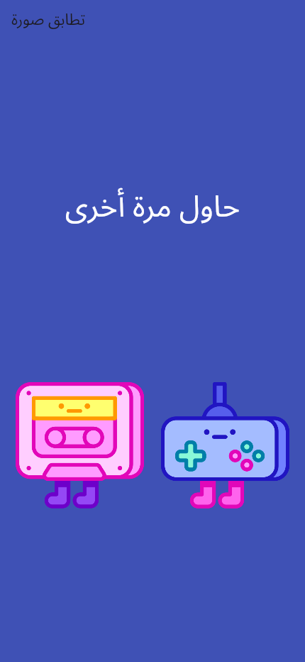
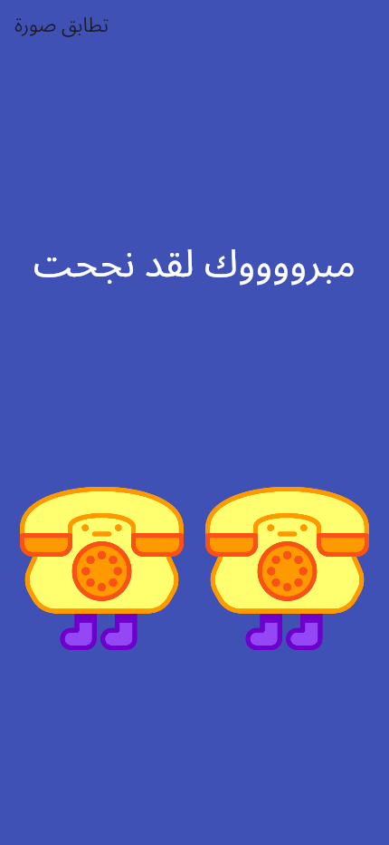

# Image Match

A simple Arabic Flutter image-matching game. Tap either picture to randomly draw both pictures again; matching images display a success message.

## Screenshots

Real local web captures. The matching pair was reached through the application's own button actions, without setting internal state.

| Initial pair | Matching pair |
| --- | --- |
|  |  |

## How it works

lib/main.dart contains the Material interface and StatefulWidget. dart:math selects each image independently from eight bundled images in images/. A setState call updates both images and the Arabic feedback text. This is a random matching exercise; it does not implement a memory-card grid, levels, scoring, persistence, or a backend.

## Run

With Flutter and Dart 3.10.8 or a compatible SDK installed:

```sh
flutter pub get
flutter run -d chrome
flutter build web --release --no-web-resources-cdn
```

No credentials or services are required. The release web build passed with Flutter 3.38.9 and both initial/success states were exercised locally. Native platform builds were not validated.
